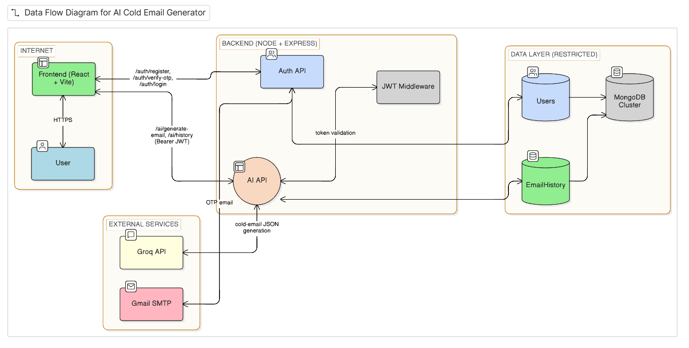

# MailGen AI — AI Cold Email Generator

[](https://github.com/swinter-ctrl/MailGen-AI/actions/workflows/ci.yml)


A full-stack MERN application that turns a one-line prompt into a complete job-outreach kit: a **cold email**, a **LinkedIn DM**, and a **follow-up email**. Generations are powered by a Large Language Model through the Groq API.

**🔗 Live demo:** https://mailgen-ai-eacj.onrender.com
*(hosted on Render's free tier — the first request may take ~30 seconds while the server wakes up)*

---

## ✨ Features

- **AI outreach generation** — one prompt (e.g. *"Cold email for a backend intern role at Razorpay, I know Node.js"*) produces a subject line, email body, LinkedIn DM, and follow-up email.
- **Structured LLM output** — the model is prompted to return JSON, which the server validates before saving.
- **Secure authentication** — sign-up with email OTP verification (10-minute expiry), bcrypt password hashing, and JWT-protected routes.
- **Generation history** — every result is saved per user in MongoDB and can be revisited from the dashboard.
- **One-click copy** — copy any generated message to the clipboard.
- **Production-ready delivery** — multi-stage Docker image, Docker Compose setup, and a GitHub Actions CI/CD pipeline.

---

## 🛠 Tech Stack

| Layer | Technologies |
|-------|--------------|
| Frontend | React 18, Vite, Tailwind CSS, React Router, Axios, React Hot Toast |
| Backend | Node.js, Express, JWT, bcrypt, Nodemailer |
| Database | MongoDB Atlas, Mongoose |
| AI | Groq API (`openai/gpt-oss-120b` by default) |
| DevOps | Docker, Docker Compose, GitHub Actions, GitHub Container Registry, Render |

---

## 🏗 Architecture



In production a single Express server serves both the REST API (`/api/*`) and the built React app, so the whole application runs as one service on one URL.

```
MailGen-AI/
├── client/                 # React + Vite frontend
│   └── src/
│       ├── pages/          # Landing, Login, Signup, VerifyOtp, Dashboard
│       ├── components/     # Layout, Navbar, Sidebar
│       ├── context/        # AuthContext (stores user + JWT)
│       └── utils/api.js    # Axios instance that attaches the JWT
├── server/                 # Express backend
│   ├── controllers/        # authController, aiController
│   ├── middleware/         # JWT "protect" middleware
│   ├── models/             # User, EmailHistory (Mongoose)
│   ├── routes/             # /api/auth, /api/ai
│   ├── utils/              # Nodemailer email service
│   └── server.js           # App entry: API + static client + health check
├── Dockerfile              # Multi-stage production image
├── docker-compose.yml      # App + MongoDB for local use
├── render.yaml             # Render Blueprint
└── .github/workflows/ci.yml
```

---

## 📡 API Reference

| Method | Endpoint | Auth | Description |
|--------|----------|------|-------------|
| `POST` | `/api/auth/register` | — | Create an account and email a 6-digit OTP |
| `POST` | `/api/auth/verify-otp` | — | Verify the OTP; returns a JWT |
| `POST` | `/api/auth/login` | — | Log in (verified users only); returns a JWT |
| `POST` | `/api/ai/generate-email` | Bearer JWT | Generate an outreach kit from `{ "prompt": "..." }` |
| `GET` | `/api/ai/history` | Bearer JWT | List the user's previous generations |
| `GET` | `/api/health` | — | Service status and database connectivity |

A ready-made Postman collection is included: [`AI-Cold-Email-Generator.postman_collection.json`](AI-Cold-Email-Generator.postman_collection.json).

---

## 🚀 Getting Started (Local Development)

### Prerequisites
- Node.js 18+ (22 recommended)
- A MongoDB connection string ([MongoDB Atlas](https://www.mongodb.com/cloud/atlas) free tier works)
- A Groq API key ([console.groq.com/keys](https://console.groq.com/keys))
- A Gmail account with an [App Password](https://myaccount.google.com/apppasswords) for OTP emails

### 1. Install dependencies
```bash
npm run install-all
```

### 2. Configure environment variables

`server/.env`
```env
PORT=5000
MONGODB_URI=mongodb+srv://<user>:<password>@<cluster>.mongodb.net/mailgen
JWT_SECRET=<long-random-string>
GROQ_API_KEY=gsk_...
EMAIL_USER=you@gmail.com
EMAIL_PASS=<16-character app password>
FRONTEND_URL=http://localhost:5173
# Optional: override the default model
# GROQ_MODEL=openai/gpt-oss-120b
```

`client/.env`
```env
VITE_API_URL=http://localhost:5000/api
```

> Generate a strong JWT secret with:
> `node -e "console.log(require('crypto').randomBytes(48).toString('base64url'))"`

### 3. Run
```bash
npm run dev
```
- Frontend: http://localhost:5173
- API: http://localhost:5000

---

## 🐳 Running with Docker

The multi-stage `Dockerfile` builds the React client in a throwaway stage, then copies only the compiled files into a slim Node 22 runtime with production dependencies. The final image runs as a non-root user and includes a health check against `/api/health`.

```bash
# 1. Create server/.env as shown above (MONGODB_URI is overridden automatically)
# 2. Build and start the app + MongoDB
docker compose up --build
```

Open http://localhost:5000 · Health check: http://localhost:5000/api/health

```bash
docker compose down        # stop
docker compose down -v     # stop and delete the database volume
```

The latest image is also published to GitHub Container Registry:
```bash
docker pull ghcr.io/swinter-ctrl/mailgen-ai:latest
```

---

## 🔁 CI/CD Pipeline

[`.github/workflows/ci.yml`](.github/workflows/ci.yml) runs on every push and pull request to `main`:

```
push / PR
   │
   ├─ 1. Build & check ─────────── npm ci (client + server)
   │                                syntax-check server code
   │                                vite build
   │
   ├─ 2. Docker smoke test ──────── build production image
   │                                run it against a MongoDB service container
   │                                assert: /api/health reports DB connected,
   │                                        frontend is served,
   │                                        unknown API routes return 404
   │
   └─ 3. Publish (main only) ────── push image to ghcr.io (latest + commit SHA)
                                         │
                                         ▼
                            Render deploys after checks pass
```

---

## ☁️ Deployment (Render)

The repository includes a [`render.yaml`](render.yaml) Blueprint that deploys the app as a single web service.

1. Push the repository to GitHub.
2. On [Render](https://render.com), choose **New → Blueprint** and select the repository.
3. Fill in `MONGODB_URI`, `GROQ_API_KEY`, `EMAIL_USER`, and `EMAIL_PASS` (`JWT_SECRET` is generated automatically).
4. In MongoDB Atlas → Network Access, allow `0.0.0.0/0` (Render's free tier has no static IP).
5. Under **Settings → Build & Deploy → Auto-Deploy**, select **After CI Checks Pass**.

**Manual setup (without the Blueprint):**
- Build command: `npm install && npm run build`
- Start command: `npm start`

---

## ⚠️ Known Limitations

- **OTP emails on Render's free tier:** free web services block outbound SMTP, so Gmail OTP emails time out in production. Use a paid instance, or switch `server/utils/emailService.js` to an HTTP email API such as Resend or Brevo.
- **Cold starts:** free-tier instances sleep after inactivity; the first request can take ~30 seconds.

---

## 🗺 Roadmap

- [ ] HTTP-based email provider for OTP delivery
- [ ] Resend-OTP flow
- [ ] Unit and integration tests in CI
- [ ] Tone and length controls for generated messages

---

## 👤 Author

**Utkarsh Pal** · GitHub: [TechTinker5](https://github.com/TechTinker5)

If you found this project useful, consider giving it a ⭐.
